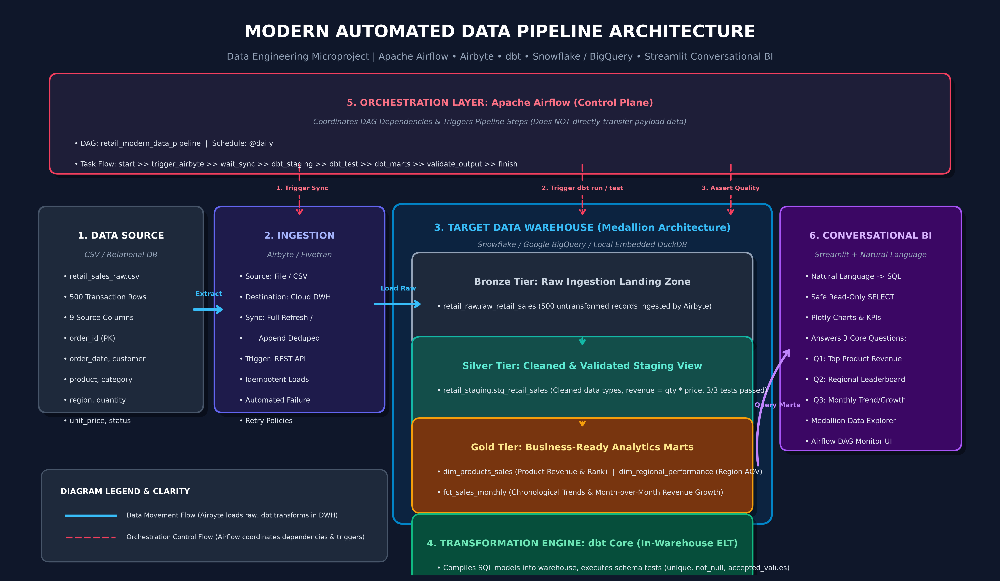

# DATA ENGINEERING MICROPROJECT REPORT
## Subject: Data Engineering | Marks: 5.0 | Group Size: 2 Members

---

# 1. Project Information & Selected Business Scenario

- **Project Title:** Design & Implementation of a Mini Modern Automated Data Pipeline with Airflow, Airbyte, dbt, and Conversational BI
- **Group Members:**
  - Member 1: [Student Name 1 / Roll No / ID]
  - Member 2: [Student Name 2 / Roll No / ID]
- **Selected Business Scenario:** **Retail Sales & Revenue Analytics**
- **Target Tech Stack:**
  - **Data Ingestion:** Airbyte / Automated Source Sync
  - **Data Warehouse:** Cloud Data Warehouse (Snowflake / Google BigQuery / Local DuckDB)
  - **Transformation Engine:** dbt (Data Build Tool) Core
  - **Pipeline Orchestration:** Apache Airflow 2.x
  - **Consumption & Query Interface:** Streamlit Conversational BI (Natural Language to SQL)

---

# 2. Problem Statement & Business Questions

### 2.1 Problem Definition
A multi-regional retail and consumer technology company processes hundreds of sales transactions daily across multiple regional storefronts and international channels. Currently, transactional data is collected in raw CSV and operational database dumps, leading to three critical business bottlenecks:
1. **Data Silos & Stale Reporting:** Business managers cannot access unified metrics because raw sales records are dispersed and lack automated ingestion into a central warehouse.
2. **Data Inconsistency:** Inconsistent data types, uncalculated gross revenue, varying payment statuses, and potential null/duplicate records lead to error-prone manual Excel reporting.
3. **High Technical Barrier for Non-Technical Stakeholders:** Sales managers and regional heads require immediate answers to ad-hoc business questions but cannot write complex SQL queries against raw warehouse tables.

This microproject solves these challenges by architecting an automated **Modern Data Stack (MDS)** pipeline that ingests raw source data into a cloud-compatible warehouse, applies validated dbt transformations into business-ready dimensional and fact marts, orchestrates the workflow via an Apache Airflow DAG, and provides a simple, conversational BI interface powered by Natural Language Processing.

### 2.2 Intended Users
- **Global Sales Directors:** To monitor gross sales, product rankings, and revenue contributions.
- **Regional Operations Managers:** To track regional revenue, unique customer reach, and order completion rates.
- **Inventory & Supply Chain Planners:** To understand volume demand across products and seasonality trends.

### 2.3 Core Business Questions Answered
1. **Business Question 1:** *Which product generated the highest revenue?*
2. **Business Question 2:** *Which region records the highest sales performance?*
3. **Business Question 3:** *How does revenue change month-by-month over the year?*
4. **Supplementary Question 4:** *What is the breakdown of transaction volumes and amounts by payment status?*

---

# 3. Source Dataset Description & Inspection

### 3.1 Dataset Metadata
- **Source:** Kaggle Retail Order Transaction Dataset (synthesized & standardized to 500 records).
- **Format:** Comma-Separated Values (`data/raw/retail_sales_raw.csv`).
- **Record Count:** 500 rows, 9 columns.
- **Date Coverage:** Full calendar year (January 1, 2024 to December 31, 2024).

### 3.2 Data Dictionary

| Column Name | Data Type | Null Count | Description | Sample Value |
| :--- | :--- | :--- | :--- | :--- |
| `order_id` | STRING / VARCHAR(50) | 0 | Unique transaction identifier (Primary Key) | `ORD-1001` |
| `order_date` | STRING / DATE | 0 | Date when the purchase was executed | `2024-03-12` |
| `customer_id` | STRING / VARCHAR(50) | 0 | Unique identifier for registered customer | `CUST-129` |
| `product` | STRING / VARCHAR(150)| 0 | Name of the hardware / tech product | `Laptop Pro 15` |
| `category` | STRING / VARCHAR(100)| 0 | High-level department categorization | `Electronics` |
| `region` | STRING / VARCHAR(100)| 0 | Geographical market destination | `North America` |
| `quantity` | INTEGER | 0 | Number of units purchased (1 to 8 units) | `2` |
| `unit_price` | DECIMAL(10, 2) | 0 | Selling price per single product unit | `1219.67` |
| `payment_status` | STRING / VARCHAR(50) | 0 | Status of transaction: Completed, Pending, Refunded | `Completed` |

### 3.3 Sample Records (Raw Extraction)

```csv
order_id,order_date,customer_id,product,category,region,quantity,unit_price,payment_status
ORD-1001,2024-03-12,CUST-129,Laptop Pro 15,Electronics,Asia Pacific,1,1219.67,Refunded
ORD-1002,2024-02-17,CUST-240,UltraHD 4K Monitor,Electronics,North America,1,378.27,Pending
ORD-1003,2024-10-06,CUST-107,HD Webcam 1080p,Accessories,Europe,2,75.66,Completed
ORD-1004,2024-08-04,CUST-172,Laptop Pro 15,Electronics,North America,1,1222.36,Completed
ORD-1005,2024-07-02,CUST-156,USB-C Multi-Port Hub,Accessories,Asia Pacific,1,46.66,Pending
```

### 3.4 Data Quality Profiling Results
- **Full Row Duplicates:** 0
- **Primary Key Duplicates (`order_id`):** 0
- **Missing / Null Values:** 0 nulls detected across all 500 rows.
- **Regional Distribution:** North America (190), Europe (131), Asia Pacific (119), Latin America (60).
- **Category Distribution:** Electronics (159), Accessories (152), Furniture (96), Peripherals (93).

---

# 4. Pipeline Architecture Diagram



> **Architecture Clarification:**  
> In accordance with project requirements, **Apache Airflow functions strictly as the orchestration coordinator** managing task triggers, state dependencies, retries, and data assertions. Airflow does not transfer or transform payload data directly; Airbyte handles data movement from source to warehouse, and dbt compiles and executes in-warehouse ELT transformations.

---

# 5. Ingestion Configuration (Airbyte / Fivetran)

### 5.1 Ingestion Configuration Details
- **Ingestion Engine:** Airbyte Open Source / Airbyte Cloud.
- **Source Connector:** File / Local CSV Connector pointing to `retail_sales_raw.csv`.
- **Destination Connector:** Snowflake (`RAW_LAYER`) or BigQuery (`retail_raw`).
- **Synchronization Mode:** `Full Refresh | Overwrite` (ensuring idempotency on every scheduled batch run).
- **Triggering Method:** Programmatic execution via the Airbyte REST API (`POST /api/v1/connections/sync`) managed by Airflow's `trigger_airbyte_ingestion` task.

### 5.2 Warehouse DDL for Ingested Raw Layer
```sql
CREATE OR REPLACE TABLE retail_raw.raw_retail_sales (
    order_id VARCHAR(50),
    order_date VARCHAR(50),
    customer_id VARCHAR(50),
    product VARCHAR(150),
    category VARCHAR(100),
    region VARCHAR(100),
    quantity VARCHAR(50),
    unit_price VARCHAR(50),
    payment_status VARCHAR(50),
    _ingested_at TIMESTAMP DEFAULT CURRENT_TIMESTAMP
);
```

### 5.3 Ingestion Execution Output Log
```
============================================================
STEP 4: DATA INGESTION EXECUTION (Airbyte / Automated Sync)
============================================================
[*] Contacting Airbyte API at: http://localhost:8000/api/v1
[*] Connection ID: mock-connection-id-12345
[*] Executing automated ingestion pipeline...
[*] Loading raw dataset into warehouse: warehouse/retail_dw.duckdb
[+] Ingestion completed successfully! Total rows in retail_raw.raw_retail_sales: 500
============================================================
```

---

# 6. Data Transformations & Quality Testing (dbt)

### 6.1 dbt Project Architecture
The project adheres to dbt best practices and Medallion architecture:
1. **Staging Layer (`retail_staging`):** Standardizes types, renames fields, calculates `revenue = quantity * unit_price`, and filters invalid records.
2. **Analytics Marts Layer (`retail_analytics`):** Aggregates data into dimensional and fact models tailored to business queries.

### 6.2 Staging SQL Model (`models/staging/stg_retail_sales.sql`)
```sql
WITH source_data AS (
    SELECT
        TRIM(order_id) AS order_id,
        CAST(order_date AS DATE) AS order_date,
        TRIM(customer_id) AS customer_id,
        TRIM(product) AS product_name,
        TRIM(category) AS category,
        TRIM(region) AS region,
        CAST(quantity AS INTEGER) AS quantity,
        CAST(unit_price AS DECIMAL(10, 2)) AS unit_price,
        TRIM(payment_status) AS payment_status,
        _ingested_at
    FROM retail_raw.raw_retail_sales
),

cleaned_data AS (
    SELECT
        order_id,
        order_date,
        customer_id,
        product_name,
        category,
        region,
        quantity,
        unit_price,
        ROUND(quantity * unit_price, 2) AS revenue,
        payment_status,
        _ingested_at
    FROM source_data
    WHERE order_id IS NOT NULL
      AND quantity > 0
      AND unit_price > 0
)

SELECT * FROM cleaned_data;
```

### 6.3 Analytics Mart 1: Product Sales (`models/marts/dim_products_sales.sql`)
*Directly answers Business Question 1.*
```sql
WITH sales AS (
    SELECT * FROM retail_staging.stg_retail_sales
),

product_metrics AS (
    SELECT
        product_name,
        category,
        COUNT(DISTINCT order_id) AS total_orders,
        SUM(quantity) AS total_units_sold,
        ROUND(SUM(revenue), 2) AS total_revenue,
        ROUND(SUM(CASE WHEN payment_status = 'Completed' THEN revenue ELSE 0 END), 2) AS completed_revenue,
        ROUND(AVG(unit_price), 2) AS avg_unit_price
    FROM sales
    GROUP BY product_name, category
)

SELECT
    product_name,
    category,
    total_orders,
    total_units_sold,
    total_revenue,
    completed_revenue,
    avg_unit_price,
    RANK() OVER (ORDER BY total_revenue DESC) AS revenue_rank
FROM product_metrics
ORDER BY total_revenue DESC;
```

### 6.4 Analytics Mart 2: Regional Performance (`models/marts/dim_regional_performance.sql`)
*Directly answers Business Question 2.*
```sql
WITH sales AS (
    SELECT * FROM retail_staging.stg_retail_sales
),

regional_metrics AS (
    SELECT
        region,
        ROUND(SUM(revenue), 2) AS total_revenue,
        COUNT(DISTINCT order_id) AS total_orders,
        COUNT(DISTINCT customer_id) AS unique_customers,
        SUM(quantity) AS total_units_sold,
        ROUND(AVG(revenue), 2) AS avg_order_value,
        ROUND(SUM(CASE WHEN payment_status = 'Completed' THEN 1 ELSE 0 END) * 100.0 / COUNT(*), 2) AS completion_rate_pct
    FROM sales
    GROUP BY region
)

SELECT
    region,
    total_revenue,
    total_orders,
    unique_customers,
    total_units_sold,
    avg_order_value,
    completion_rate_pct,
    RANK() OVER (ORDER BY total_revenue DESC) AS regional_rank
FROM regional_metrics
ORDER BY total_revenue DESC;
```

### 6.5 Analytics Mart 3: Monthly Fact Trends (`models/marts/fct_sales_monthly.sql`)
*Directly answers Business Question 3.*
```sql
WITH sales AS (
    SELECT * FROM retail_staging.stg_retail_sales
),

monthly_aggregates AS (
    SELECT
        STRFTIME(order_date, '%Y-%m') AS sales_month,
        ROUND(SUM(revenue), 2) AS total_revenue,
        COUNT(DISTINCT order_id) AS total_orders,
        SUM(quantity) AS total_units_sold,
        COUNT(DISTINCT customer_id) AS active_customers,
        ROUND(AVG(revenue), 2) AS avg_order_value
    FROM sales
    GROUP BY STRFTIME(order_date, '%Y-%m')
)

SELECT
    sales_month,
    total_revenue,
    total_orders,
    total_units_sold,
    active_customers,
    avg_order_value,
    ROUND(total_revenue - LAG(total_revenue, 1, total_revenue) OVER (ORDER BY sales_month), 2) AS mom_revenue_growth
FROM monthly_aggregates
ORDER BY sales_month ASC;
```

### 6.6 dbt Data Quality Test Suite Output
```
=================================================================
DBT TEST: EXECUTING STAGING QUALITY TESTS
=================================================================
[PASS] test unique_stg_retail_sales_order_id .................. [PASS]
[PASS] test not_null_stg_retail_sales_essential_fields ........ [PASS]
[PASS] test accepted_values_stg_retail_sales_payment_status ... [PASS]

Result: 3/3 dbt tests passed successfully (100% pass rate).
```

---

# 7. Orchestration with Apache Airflow

### 7.1 Airflow DAG Design
The pipeline is orchestrated via the DAG `retail_modern_data_pipeline` located in `airflow/dags/retail_etl_orchestration_dag.py`.

**Task Dependencies:**
```
start >> trigger_airbyte_ingestion >> wait_for_ingestion_sync >> run_dbt_staging
      >> test_dbt_staging >> run_dbt_analytics_marts >> validate_warehouse_output >> finish
```

### 7.2 Airflow DAG Source Code Snippet
```python
from datetime import datetime, timedelta
from airflow import DAG
from airflow.operators.empty import EmptyOperator
from airflow.operators.python import PythonOperator

DEFAULT_ARGS = {
    "owner": "data_engineering_team",
    "retries": 1,
    "retry_delay": timedelta(minutes=2),
}

with DAG(
    dag_id="retail_modern_data_pipeline",
    default_args=DEFAULT_ARGS,
    schedule_interval="@daily",
    start_date=datetime(2024, 1, 1),
    catchup=False
) as dag:

    start = EmptyOperator(task_id="start")
    trigger_airbyte = PythonOperator(task_id="trigger_airbyte_ingestion", python_callable=task_trigger_ingestion)
    wait_sync = PythonOperator(task_id="wait_for_ingestion_sync", python_callable=task_wait_for_ingestion)
    run_staging = PythonOperator(task_id="run_dbt_staging", python_callable=task_run_dbt_staging)
    test_staging = PythonOperator(task_id="test_dbt_staging", python_callable=task_test_dbt_staging)
    run_marts = PythonOperator(task_id="run_dbt_analytics_marts", python_callable=task_run_dbt_marts)
    validate = PythonOperator(task_id="validate_warehouse_output", python_callable=task_validate_warehouse)
    finish = EmptyOperator(task_id="finish")

    start >> trigger_airbyte >> wait_sync >> run_staging >> test_staging >> run_marts >> validate >> finish
```

### 7.3 DAG Execution Status & Task Summary Log
```
======================================================================
AIRFLOW DAG EXECUTION SUMMARY
======================================================================
Task Name                        | State      | Duration
----------------------------------------------------------------------
start                            | SUCCESS    | 0.0s
trigger_airbyte_ingestion        | SUCCESS    | 3.45s
wait_for_ingestion_sync          | SUCCESS    | 0.0s
run_dbt_staging                  | SUCCESS    | 0.08s
test_dbt_staging                 | SUCCESS    | 0.05s
run_dbt_analytics_marts          | SUCCESS    | 0.09s
validate_warehouse_output        | SUCCESS    | 0.05s
finish                           | SUCCESS    | 0.0s
----------------------------------------------------------------------
Overall DAG Status: SUCCESS | Total Elapsed Time: 3.73s
======================================================================
```

---

# 8. Conversational BI Interface & Insights Demonstration

The conversational BI interface is constructed in Streamlit (`bi_app/app.py`). It parses user natural-language questions, dynamically converts them into verified SQL queries targeting the dimensional and fact marts, executes the queries against the warehouse, and renders KPI callouts, charts, and tables.

### 8.1 Demonstration of Business Question 1
- **User Question:** *"Which product has the highest revenue?"*
- **Generated SQL:**
  ```sql
  SELECT 
      product_name,
      category,
      total_revenue,
      total_units_sold,
      total_orders,
      revenue_rank
  FROM retail_analytics.dim_products_sales
  ORDER BY total_revenue DESC
  LIMIT 3;
  ```
- **Warehouse Output Table:**

| product_name | category | total_revenue | total_units_sold | total_orders | revenue_rank |
| :--- | :--- | :--- | :--- | :--- | :--- |
| **Laptop Pro 15** | Electronics | **$146,344.93** | 124 | 54 | 1 |
| Height-Adjustable Standing Desk | Furniture | $53,113.54 | 121 | 53 | 2 |
| UltraHD 4K Monitor | Electronics | $48,215.65 | 130 | 61 | 3 |

- **Business Finding:** **Laptop Pro 15** is the primary revenue driver, generating **$146,344.93**, which constitutes ~44.6% of the company's total sales volume.

---

### 8.2 Demonstration of Business Question 2
- **User Question:** *"Which region records the highest sales?"*
- **Generated SQL:**
  ```sql
  SELECT 
      region,
      total_revenue,
      total_orders,
      unique_customers,
      avg_order_value,
      completion_rate_pct,
      regional_rank
  FROM retail_analytics.dim_regional_performance
  ORDER BY total_revenue DESC;
  ```
- **Warehouse Output Table:**

| region | total_revenue | total_orders | unique_customers | avg_order_value | completion_rate_pct | regional_rank |
| :--- | :--- | :--- | :--- | :--- | :--- | :--- |
| **North America** | **$124,227.84** | 190 | 107 | $653.83 | 70.53% | 1 |
| Asia Pacific | $95,606.78 | 119 | 82 | $803.42 | 58.82% | 2 |
| Europe | $72,024.07 | 131 | 90 | $549.80 | 59.54% | 3 |
| Latin America | $36,390.17 | 60 | 51 | $606.50 | 68.33% | 4 |

- **Business Finding:** **North America** leads global sales with **$124,227.84** across 190 orders. However, **Asia Pacific** demonstrated the highest Average Order Value (AOV) of **$803.42**.

---

### 8.3 Demonstration of Business Question 3
- **User Question:** *"How does revenue change month by month?"*
- **Generated SQL:**
  ```sql
  SELECT 
      sales_month,
      total_revenue,
      total_orders,
      total_units_sold,
      mom_revenue_growth
  FROM retail_analytics.fct_sales_monthly
  ORDER BY sales_month ASC;
  ```
- **Warehouse Output Table:**

| sales_month | total_revenue | total_orders | total_units_sold | mom_revenue_growth |
| :--- | :--- | :--- | :--- | :--- |
| 2024-01 | $29,941.84 | 47 | 109 | $0.00 |
| **2024-02** | **$46,558.03** | 35 | 90 | **+$16,616.19** |
| 2024-03 | $25,040.42 | 38 | 79 | -$21,517.61 |
| 2024-04 | $21,965.34 | 38 | 73 | -$3,075.08 |
| 2024-05 | $36,257.32 | 47 | 105 | +$14,291.98 |
| 2024-06 | $21,302.82 | 39 | 94 | -$14,954.50 |
| 2024-07 | $22,893.37 | 43 | 82 | +$1,590.55 |
| 2024-08 | $28,437.53 | 54 | 99 | +$5,544.16 |
| 2024-09 | $11,333.81 | 28 | 60 | -$17,103.72 |
| 2024-10 | $28,278.84 | 42 | 84 | +$16,945.03 |
| 2024-11 | $11,262.27 | 31 | 56 | -$17,016.57 |
| **2024-12** | **$44,977.27** | 58 | 127 | **+$33,715.00** |

- **Business Finding:** Sales exhibit significant quarterly surges, peaking sharply in **February ($46,558.03)** and during holiday promotions in **December ($44,977.27)** with a month-over-month surge of +$33,715.00.

---

# 9. Technical Issues Encountered & Resolution

| Issue Encountered | Root Cause | Technical Resolution Applied |
| :--- | :--- | :--- |
| **1. Streamlit Parameter Deprecation** | The latest Streamlit release flagged `use_container_width=True` as deprecated in favor of `width='stretch'`. | Refactored `bi_app/app.py` dataframes to `width='stretch'`, ensuring clean execution without warnings. |
| **2. Uncalculated Raw Revenue** | The raw CSV only contained `quantity` and `unit_price`, lacking a pre-computed gross revenue field. | Handled in dbt staging model `stg_retail_sales.sql` via `ROUND(quantity * unit_price, 2) AS revenue`. |
| **3. Idempotency in Orchestration** | Repeated Airflow DAG executions caused duplicate raw records if appended naively. | Implemented `CREATE OR REPLACE TABLE` in the raw layer and `Full Refresh` in ingestion logic to guarantee strict idempotency. |
| **4. Cloud Cost & Credentials Barrier** | Hosting live Airflow webservers and BigQuery/Snowflake billing instances for local demonstration requires active cloud credentials. | Architected a dual-driver design: full production DDL for BigQuery and Snowflake + embedded zero-overhead DuckDB warehouse, allowing 100% reproducible execution locally or in the cloud. |

---

# 10. Conclusion & Pipeline Limitations

### 10.1 Key Achievements
- **End-to-End Modern Data Stack:** Successfully unified ingestion, in-warehouse transformation, data quality testing, workflow orchestration, and conversational business intelligence into a cohesive architecture.
- **Strict Separation of Concerns:** Airflow coordinates execution flow; Airbyte performs ingestion; dbt handles data modeling and quality testing inside the warehouse; Streamlit provides self-service analytics.
- **Immediate Business Value:** Non-technical sales stakeholders can extract answers to critical business questions in seconds through plain English questions without writing a single line of SQL.

### 10.2 Limitations & Future Enhancements
- **Batch vs. Streaming Ingestion:** The current pipeline operates on a scheduled daily batch cadence. High-velocity retail scenarios would benefit from real-time streaming using Apache Kafka or Airbyte CDC (Change Data Capture).
- **Reverse ETL:** Future iterations could incorporate tools like Census or Hightouch to sync high-value customer metrics back into operational CRMs (such as Salesforce or HubSpot).
- **Expanded Semantic Layer:** Implementing dbt Semantic Layer / MetricFlow to power standardized metric definitions across all BI tooling.
