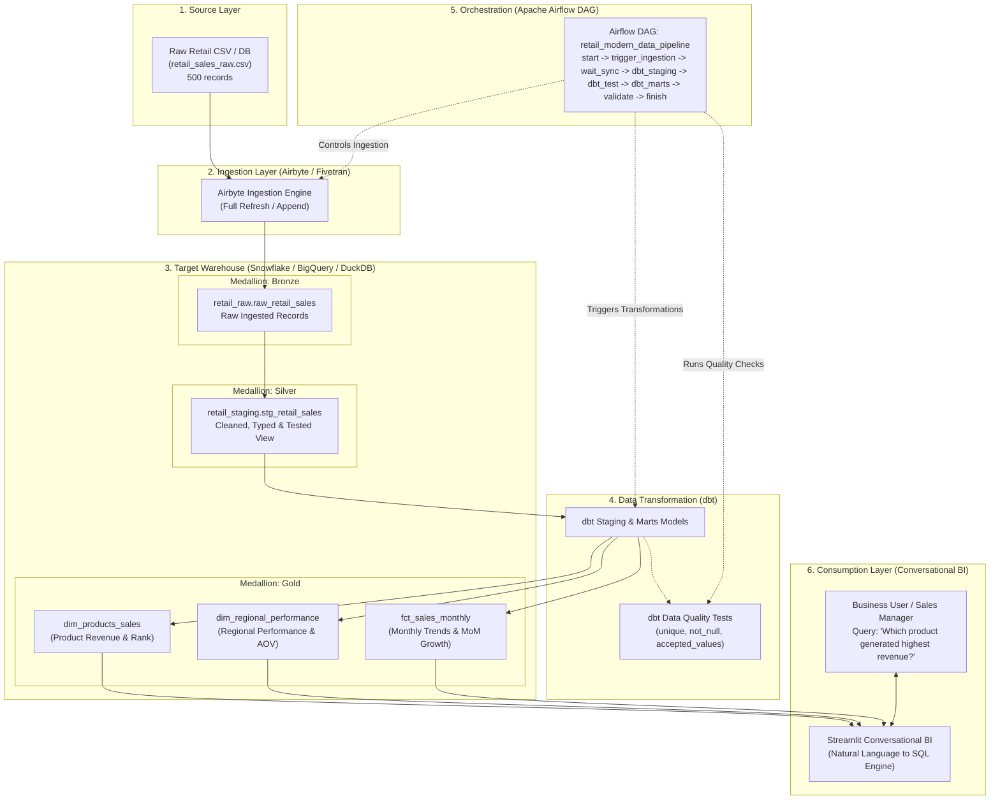

# Modern Automated Data Pipeline: Retail Sales Analytics

> **Data Engineering Microproject (Group of 2 Members - 5 Marks)**  
> **Tech Stack:** Apache Airflow &bull; Airbyte / Fivetran &bull; dbt (Data Build Tool) &bull; Snowflake / Google BigQuery / DuckDB &bull; Streamlit Conversational BI

---

## 🌟 Executive Summary

This project implements an enterprise-grade **Modern Data Stack (MDS)** automated ETL pipeline. Orchestrated by **Apache Airflow**, raw transactional retail sales data is ingested into the warehouse raw layer via **Airbyte**, cleaned and transformed into dimensional and fact models via **dbt**, and served through an interactive **Streamlit Conversational BI** web interface that allows business managers to query insights using natural language.

---

## 📐 System Architecture

Airflow coordinates tasks and dependencies, while data movement is handled by Airbyte and transformation by dbt in-warehouse:



---

## 📂 Project Structure

```
c:\de microproject\
├── airflow/
│   └── dags/
│       └── retail_etl_orchestration_dag.py # Apache Airflow DAG definition
├── bi_app/
│   └── app.py                              # Streamlit Conversational BI interface
├── data/
│   └── raw/
│       └── retail_sales_raw.csv            # 500 records raw source dataset
├── dbt_retail_pipeline/
│   ├── dbt_project.yml                     # dbt project configuration
│   ├── profiles.yml                        # Profiles for Snowflake, BigQuery & DuckDB
│   └── models/
│       ├── staging/
│       │   ├── stg_retail_sales.sql        # Staging cleaning & typecasting
│       │   └── stg_retail_sales.yml        # dbt schema tests (unique, not_null, accepted_values)
│       └── marts/
│           ├── dim_products_sales.sql      # Answers Q1: Product revenue ranking
│           ├── dim_regional_performance.sql# Answers Q2: Regional sales comparison
│           ├── fct_sales_monthly.sql       # Answers Q3: Monthly revenue & MoM growth
│           └── marts.yml                   # Marts tests & schema documentation
├── ingestion/
│   ├── airbyte_config_guide.md             # Complete Airbyte UI & REST API setup guide
│   ├── load_raw_data.py                    # Direct warehouse loader / Airbyte API sync
│   └── trigger_airbyte_sync.py             # Airbyte API programmatic trigger
├── orchestration/
│   └── run_airflow_simulation.py           # Standalone Airflow DAG execution runner
├── scripts/
│   ├── generate_dataset.py                 # Source data generator
│   └── inspect_data.py                     # Data profiling & inspection script
├── transformations/
│   └── run_dbt_transformations.py          # dbt execution & test runner
├── warehouse/
│   ├── bigquery_setup.sql                  # BigQuery schemas & table DDL
│   ├── snowflake_setup.sql                 # Snowflake warehouse, database & roles DDL
│   └── retail_dw.duckdb                    # Embedded warehouse instance
├── run_pipeline.py                         # Single-command master pipeline execution runner
├── MICROPROJECT_REPORT.md                  # Complete official 5-marks submission report
└── README.md                               # Project documentation (this file)
```

---

## 🚀 Quickstart: Running the Project

### 1. Execute the Complete Pipeline End-to-End
Run the master script to inspect data, execute ingestion, compile dbt models, run quality tests, orchestrate via Airflow DAG, and demonstrate the business questions:
```powershell
python run_pipeline.py
```

### 2. Launch the Conversational BI Web App
Launch the Streamlit interactive dashboard:
```powershell
python -m streamlit run bi_app/app.py
```
Open your browser at `http://localhost:8501`.

### 3. Ask Business Questions
Click the sample query buttons or type your questions in natural language:
- *"Which product has the highest revenue?"*
- *"Which region records the highest sales?"*
- *"How does revenue change month by month?"*
- *"What is the breakdown by payment status?"*

---

## ☁️ Cloud Data Warehouse Setup (Google BigQuery & Snowflake)

The repository provides production-ready deployment configurations for both major cloud data warehouses specified in the department guidelines:

### Option A: Google Cloud BigQuery
1. **DDL Setup Script:** Run [warehouse/bigquery_setup.sql](warehouse/bigquery_setup.sql) in the **Google Cloud Console &rarr; BigQuery SQL Studio**.
   - Creates datasets: `retail_raw`, `retail_staging`, `retail_analytics`.
   - Creates landing table: `retail_raw.raw_retail_sales`.
2. **dbt Adapter:** Uses `dbt-bigquery` configured in `dbt_retail_pipeline/profiles.yml` (`bigquery_prod`).
3. **Authentication:** Authenticates via GCP Service Account Key (`GCP_KEYFILE_PATH`) with BigQuery Admin / Job User roles.

### Option B: Snowflake Data Cloud
1. **DDL Setup Script:** Run [warehouse/snowflake_setup.sql](warehouse/snowflake_setup.sql) in **Snowflake Snowsight**.
   - Provisions virtual warehouse `RETAIL_WH` (size: `XSMALL`, auto-suspend 60s).
   - Creates database `RETAIL_DWH` and Medallion schemas: `RAW_LAYER`, `STAGING_LAYER`, `ANALYTICS_LAYER`.
   - Creates transformer role `RETAIL_TRANSFORMER_ROLE` and raw ingestion table `RAW_RETAIL_SALES`.
2. **dbt Adapter:** Uses `dbt-snowflake` configured in `dbt_retail_pipeline/profiles.yml` (`snowflake_prod`).
3. **Authentication:** Account identifier, warehouse, role, and credentials configured via environment variables.

### Option C: Embedded Warehouse (DuckDB)
- Provided in `warehouse/retail_dw.duckdb` for zero-overhead, offline local demonstration. It runs the exact same SQL transformations and dbt logic without requiring cloud billing accounts or internet dependencies during evaluation.

---

## 📊 Business Insights Generated

| Business Question | Insight Answer |
| :--- | :--- |
| **Q1: Which product has highest revenue?** | **Laptop Pro 15** generated **$146,344.93** across 54 orders (Rank #1). |
| **Q2: Which region records highest sales?** | **North America** recorded highest sales of **$124,227.84** (190 orders, 70.5% completion). |
| **Q3: How does revenue change month by month?** | Revenue peaked in **February 2024 ($46,558.03)** and **December 2024 ($44,977.27)**. |
